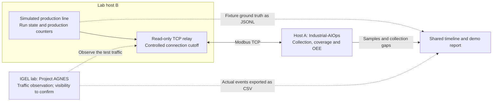

# Industrial-AIOps 0.33.0 — integration evaluation

A small, source-based handoff for testing Industrial-AIOps alongside an edge
traffic-monitoring application. Baseline: release commit `513951e` (0.33.0).
No UMS installer, licence, credentials or customer data is included.

## Prerequisites

Use Bash, Git and Python 3.11 or newer on a lab machine. Check the interpreter
before creating the virtual environment:

```bash
python3 --version
python3 -c 'import sys; assert sys.version_info >= (3, 11), "Python 3.11+ required"'
```

If `python3` is older, use an installed Python 3.11+ interpreter instead for the
venv command below. On Ubuntu, the corresponding Python venv package must also
be installed. A fresh installation needs access to GitHub and Python packages.

## Next joint lab test

The demo now compares a production stop with healthy communications against a
collection connection cutoff while simulated production continues. Industrial-AIOps
provides the production-state and collection-gap evidence; the IGEL lab monitor can
contribute actual network events to the same timeline once visibility is confirmed.

The shared Project AGNES diagram describes network observation and local AI
analysis on the IGEL platform. This exercise adds production-state and collection
coverage evidence alongside that network view. Capture visibility, event export
and any future API integration still need to be checked in the IGEL lab; no
AGNES-specific API, Ollama instance or model is required for the local demo.

Start with the local demo below. Then follow the
[two-host guide](../../../demo/joint-traffic/README.md) to observe the test traffic
in your lab and compare the evidence. The guide includes a CSV import format;
no proprietary monitor API integration is required for this first exercise.

## Demo topology



The monitor's capture visibility and export capability must be confirmed in the
lab. Dashed arrows show the proposed observation and manual evidence-import
paths; they do not imply a completed monitor API integration. Fixture ground
truth stays separate from collector observations and imported monitor events.

## 1. Get the source

```bash
git clone --depth 1 --branch delivery/igel-evaluation-033 \
  https://github.com/industrial-aiops/industrial-aiops.git
cd industrial-aiops
```

If you already cloned this handoff branch, update it from that checkout:

```bash
git pull --ff-only
```

Then repeat the installation step below to update the installed local package.

Alternatively extract the supplied source archive and enter its top directory.
Use a Linux machine or Ubuntu guest for the first run; Python 3.11+ and Bash
are required. A fresh install needs Internet access to resolve Python dependencies.
This is not an offline dependency bundle or a native IGEL application package.

## 2. Install

From the repository root:

```bash
python3 -m venv .venv
.venv/bin/python -m pip install --upgrade pip
.venv/bin/python -m pip install '.[modbus]'
.venv/bin/iaiops --version
```

Expected version: `iaiops 0.33.0`. Keep the virtual environment in this directory;
the demo launcher below uses it. On Ubuntu, install the venv package matching
your Python version if `python3 -m venv` is unavailable.

## 3. Run the software-only demo

```bash
bash deploy/igel/evaluation/run-demo.sh
```

Allow about two minutes. The updated joint demo compares **production stopped
while communications remain healthy** with **a collection connection cut while
the synthetic production counter continues**. No PLC, LLM or external monitor
is required for this first local run.

A successful run exits with code 0 and prints `Collected ... samples` followed
by `Report: .../joint-report.html`. Open
`dist/joint-demo-1/collector/joint-report.html` and its OEE detail link.

To view the report over local HTTP instead of opening the HTML file directly,
serve the report directory on loopback:

```bash
.venv/bin/python -m http.server 8000 --bind 127.0.0.1 \
  --directory dist/joint-demo-1/collector
```

Open `http://127.0.0.1:8000/joint-report.html`; press Ctrl+C to stop the server.
For a remote lab host, copy the report files to your workstation instead.
The output directory must be new/empty. On reruns, choose another output:

```bash
bash deploy/igel/evaluation/run-demo.sh --out dist/joint-demo-2 --run-id joint-demo-2
```

The test uses loopback TCP, isolated configuration and local audit/data stores.
It does not discover or contact a plant network. It uses an application TCP
relay cutoff, not firewall packet loss, and keeps the software backend alive.
Fixture truth and collection evidence are labelled separately.

**For the actual joint exercise**, use the two-machine instructions in
[`demo/joint-traffic/README.md`](../../../demo/joint-traffic/README.md): simulator B,
collector A, the IGEL team observing their network path, then import actual monitor
CSV events into a common timeline. No monitor findings are fabricated.

The previous single-machine OEE demo is still available at
[`demo/oee-line/`](../../../demo/oee-line/README.md).

## 4. Connect an MCP client (optional, separate from the demo)

For an approved test endpoint, configure it interactively:

```bash
.venv/bin/iaiops init
.venv/bin/iaiops doctor --skip-probe
.venv/bin/iaiops doctor
.venv/bin/iaiops readiness
```

`doctor --skip-probe` checks configuration without contacting a device;
`doctor` probes the configured endpoints. Choose only the endpoints you intend
to test. Tag meaning and production roles require human confirmation.

For an MCP client that supports local stdio servers, merge this entry into its
configuration, replacing the absolute path:

```json
{
  "mcpServers": {
    "industrial-aiops": {
      "command": "/absolute/path/industrial-aiops/.venv/bin/iaiops",
      "args": ["mcp"],
      "env": {
        "IAIOPS_MCP": "factory",
        "IAIOPS_NO_EGRESS": "1"
      }
    }
  }
}
```

This starts a stdio MCP process; it does not open an HTTP API or listening port.
Ask the client to inspect site readiness first. No-egress withholds the optional
data-export tools; it still permits configured device reads and is not a
read-only enforcement switch. All tools retain their governance and audit gates.
The first joint exercise should use only reads. No PLC logic is written.

## 5. IGEL integration exercise

First reproduce this demo in a Linux environment. Then choose IMH or IMC based
on the intended use case with the IGEL team. A Linux guest is one candidate for
this source install; for a container candidate, the published image is
`ghcr.io/industrial-aiops/iaiops:0.33.0-factory`.
See [the deployment overlay](../README.md) for existing packaging materials.
Neither route is validated on an IGEL device by this handoff. Raw-L2 networking,
physical PLC operation, UMS deployment and licensing are outside this test.

Use the [joint demo guide](../../../demo/joint-traffic/README.md) to reproduce
the two scenarios across a monitor-visible lab path. First confirm where the
monitor captures traffic and whether it exports timestamped events. The source
handoff includes a relay, collector, CSV import and report; it does not include
an integration with the IGEL lab monitor or its API.

Please send back: OS/Python versions, install/demo outcome, the HTML report,
and any sanitised error output. Do not send credentials or customer addresses.

## Verification limits

See [VERIFIED.md](VERIFIED.md) for the checks performed on this handoff.

Software TCP/simulator evidence is not physical-device evidence. The English
[handoff verification record](VERIFIED.md) lists what was and was not tested.
The Margo descriptor and any supplier packaging checks do not establish IGEL
certification or runtime compatibility. Newer branch-only OTLP telemetry and
Margo archive corrections are deliberately excluded from this release baseline.
