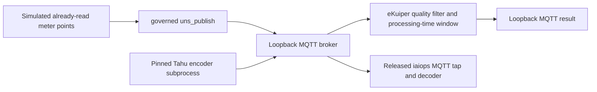

# Community integration plan and design — November 2026

Owner: wei <zhouwei008@gmail.com>. Initial execution window: **13–19 November 2026**.
External review/merge dates are controlled by each upstream community.

| Workstream | 13–14 November | 15–17 November | 18–19 November |
|---|---|---|---|
| LF Energy Landscape | Submit the energy repository entry and pure SVG logo | Address review feedback | Record accepted/pending status |
| LF Edge eKuiper | Pin stable release; run governed MQTT egress and quality/window smoke | Reconnect and event-time assessment; document reproducible setup | Review a runnable example and propose it to upstream |
| Eclipse Tahu / Sparkplug | Independent Tahu encoder through a real broker | Broaden to device lifecycle and supported datatypes; distinguish defects from unsupported scope | Submit reproducible findings or integration documentation |
| Margo | Follow CTT #20 and sandbox #490/#491; clarify update scope | If merged, rerun the unmodified official CTT commit | Update the published verification record |

## Architecture and ownership

These are operator-run examples under `demo/`, using the existing core and
connectors. They add no MCP tools, protocol implementation, scheduler or model
dependency. Any agent-facing future integration must use the existing governed
front ends. The examples cannot infer or confirm plant semantics or safety limits.

### eKuiper contract

Use released iaiops 0.34.0 and eKuiper 2.4.2. `uns_publish` accepts the top-level
`quality` field and normalizes it into `tags.quality`; arbitrary input `tags`
are not forwarded. The demo declares quality explicitly, filters good samples,
and uses `omitIfEmpty` to suppress empty-window payloads. Missing observations
are not fabricated as zero. Windows are processing-time windows: an ISO source
timestamp is carried but is not an event-time watermark configuration.

The first acceptance covers simulated values, actual governed egress, a real
MQTT broker, real eKuiper processing and observed result messages. Reconnect,
late/out-of-order event-time behavior, TLS and physical meters remain separate.

### Tahu / Sparkplug contract

Pin Eclipse Tahu to `5736e404889d4b95910613040a99ba79589ffb13`. Generate fixtures
with its original Python API/protobuf in a separate process, then publish those
bytes through the actual broker to the installed iaiops decoder. The separate
process prevents protobuf descriptor-pool collisions and confines the pure-Python
protobuf compatibility setting required by Tahu's older generated descriptors.

This supplies independent encoder interoperability evidence. The harness's
publisher is still ours; it does not validate a complete independent EoN state
machine, a commercial device or the Sparkplug TCK. Do not label it Sparkplug
Compatible. Validate broader datatypes/device state before proposing protocol fixes.

### Margo scope clarification

The sandbox maintainer confirmed on 12 November that workload updates are not
currently specified by Margo and are not implemented in sandbox; only fresh
deployments and removals are supported. The existing successful deploy/remove
trial is therefore complete for those supported operations. An in-place update
is a future capability, not a remaining blocker for that trial.
[Maintainer response](https://github.com/margo/sandbox/issues/490#issuecomment-6815806491).

CTT #20 remains a pending contribution at `149801d`; a revised-branch pass must
not be described as an unmodified upstream `dev` pass. Sandbox #491 remains a
separate report about an invalid port override and false-success CLI output.

## Submission principles

Initial execution evidence is retained in
[`evidence/community/2026-11-13.md`](evidence/community/2026-11-13.md).
LF Energy listing was submitted as
[lfenergy-landscape#1434](https://github.com/lf-energy/lfenergy-landscape/pull/1434).
The Tahu timestamp fix discovered during this work is independently submitted as
[tahu#472](https://github.com/eclipse-tahu/tahu/pull/472).

- LF Energy entry describes the released energy repository's read-only IEC-104,
  DNP3 and IEC-61850 MMS functions. Landscape listing is distinct from LF Energy
  project hosting, membership or certification.
- Submit demonstrations and findings with exact source versions and software-only
  limits; obtain upstream agreement on contribution scope before a larger adapter.
- Capture public evidence without credentials, real plant data or private governance code.
